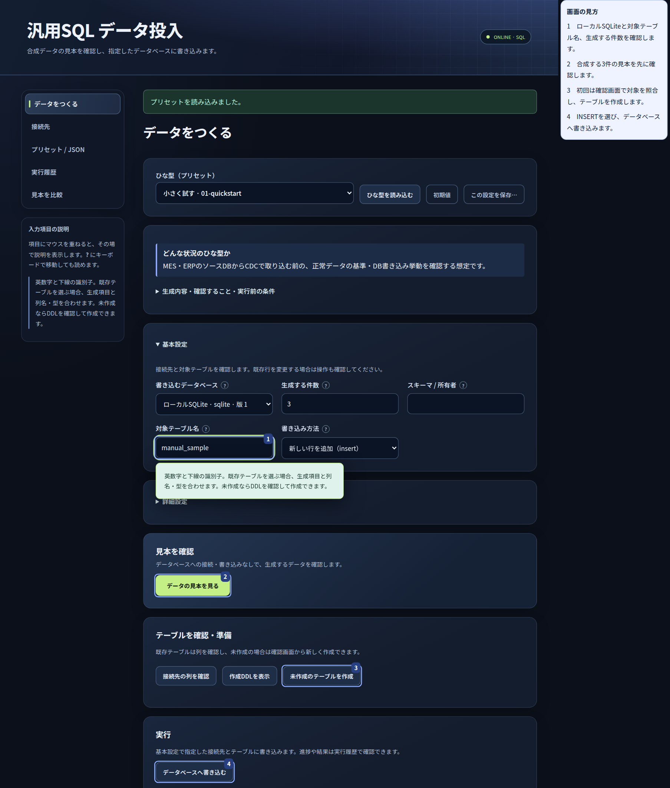

# 汎用SQLデータ投入ツール

検証用SQLiteにテーブルを作って3行追加する手順を[初心者マニュアル](docs/user-manual.md)で確認できます。

## 起動して最初の画面を開く

Linux VMに Docker Compose を用意します。別端末からの接続やホスト側のマウントは[VM導入手順](docs/vm-compose.md)を参照してください。

```sh
python3 scripts/init_local.py --private-dir ./private --data-dir ./data --env-file .env
docker compose up -d --build
```

プロジェクト名は `factory-sql-data-loader` です。旧配備を更新する場合は、実行前に[新しいボリュームと旧配備の扱い](docs/vm-compose.md#旧配備から切り替える場合)を確認します。

VMで `http://127.0.0.1:3560/` を開きます。メニューの「ヘルプ」から、見本の出し方、設定、APIを調べられます。 別端末から管理操作をする場合は[管理画面の認証](docs/vm-compose.md#管理画面の認証)も設定します。

開発時に直接起動する場合は Python 3.12〜3.14 と uv を使用します。必要なPythonは uv でインストールできます。

```sh
uv sync --frozen
DATA_DIR=./data uv run --frozen uvicorn app:app --host 127.0.0.1 --port 3560
```

## 操作と設定の資料

[8アプリの構成](docs/architecture.md)から役割と既定ポートを調べられます。

- [初心者マニュアル](docs/user-manual.md) · [ひな型を選ぶ・作る](docs/preset-guide.md) · [付属のひな型一覧](presets/README.md)
- [設定リファレンス](docs/settings-reference.md) · [JSONの書き方](docs/template-guide.md) · [AI向け作成ハーネス](docs/AI_TEMPLATE_HARNESS.md)
- [APIの使い方](docs/api-guide.md) · [用語集](docs/glossary.md) · [コードを拡張する](docs/code-reading-guide.md) · [変更履歴](CHANGELOG.md) · [レビュー対応表](docs/quality-review.md)
AIクライアント向けの接続方法は[CLI・MCPの使い方](docs/mcp.md)を参照してください。


SQL Server / Oracle / PostgreSQL / MySQL / MariaDB / SQLiteへ任意スキーマの疑似データを投入します。

[DBごとの接続・認証方式](docs/connections.md)で、SQLite以外の接続やKerberos等を確認できます。

`insert`・`upsert`・`update`・`delete` を選び、対象テーブルの列と主キーを確認します。未作成のテーブルを用意するには、画面から作成するか、管理者が表示されたDDLを適用します。既存テーブルに対して自動でDDLを実行することはありません。MySQL・MariaDB・SQLiteでは通常、スキーマ欄を空欄にします。テーブル名の例は `synthetic.sample_records` です。

新規起動時はSQL_HOSTが空ならSQLiteを自動登録します。SQLiteを試す場合は、画面でテーブルを作成してから生成してください。SQL_HOSTが指定される構成では初回だけ従来の専用writer資格情報を暗号化プロファイルへ取り込みます。

外部DBの統合テストはSQL_TEST_PROFILES_FILEへ非公開の接続プロファイル配列JSONを指定すると有効になります。

# Data Source Studio 共通仕様

各アプリは独立したコンテナと永続ボリュームを持ちます。設定は業種に依存しません。v2では接続プロファイル、任意のデータ項目、生成ルール、実行条件を画面で編集できます。

## 操作ガイド

[ひな型の選び方・詳細設定の画面・自分のひな型の作り方](docs/preset-guide.md)

[](docs/images/operation-guide.png)

「基本設定」でデータベース、テーブル、生成件数と書き込み方法を選び、「データの見本を見る」を押します。データ項目や主キー、詳細な実行条件を変えるときは「詳細設定」を開きます。

1. 「接続先」で方式と認証を選び、保存してから接続テストします。方式ごとの説明を常に表示します。各項目にマウスを重ねるか「?」へキーボードで移動すると説明が出ます。
2. 「データをつくる」で任意の項目を追加し、型と生成器を指定。詳細条件で分布、重み、NULL率、参照、計算、条件上書きを設定します。
3. 共有パラメーターをJSONで定義し、`$名前`で生成条件から参照できます。項目は上から順に生成します。
4. 「プレビュー」で最大12件の合成データを確認します。この操作ではDBに接続しません。
5. テーブル作成の前に接続先・版・テーブルを確認します。`update`・`delete`・`upsert` の実行前は、操作と生成行数も確認します。実行開始やテーブル作成の前に接続の版が変わった場合は中断し、設定を読み直します。実行後は履歴から停止と設定の再編集ができます。
6. 「この設定を保存…」でJSON編集へ進み、プリセットIDを指定して保存。JSONの読み込み・書き出しにも対応します。

確認画面の生成行数は生成条件で指定した値です。書き込みの結果は、実行履歴と対象DBの変更を照合してください。

プリセットには接続IDだけを保存します。パスワード、接続文字列、トークン、SSH秘密鍵等は接続プロファイルへ暗号化保存し、読み戻しと書き出しには含めません。空欄は同じ接続先の既存値を維持し、接続先や認証方式が変わると以前の資格情報を引き継ぎません。明示的な削除はclear_secretsで指定します。

証明書、Wallet、known_hosts、DSN設定等は接続先画面からconnection-filesへ配置できます。ファイル自体は権限600で保存します。これらのファイルと設定暗号鍵を含む永続ボリュームのバックアップは保護してください。公開リポジトリには保存しません。

## 自由なデータ定義

型はstring / integer / number / decimal / boolean / datetime / json。生成器はrecord_id、uuid、sequence、integer、uniform、normal、choice、boolean、constant、template、timestamp、reference、sum、difference、product、ratio。

日時はタイムゾーン付きISO形式を指定し、UTCへ変換します。decimalはJSONでは正確な文字列、SQLではNUMERICへ変換します。テンプレートは`DEV-{entity_no:05d}`のような先行項目・共有値・sequence・record_idの参照に対応し、任意Pythonは実行しません。JSON構造テンプレートは`$row.項目` / `$parameters.名前` / `$meta.record_key`等を参照し、入れ子のオブジェクトと配列を定義できます。

項目名・SQL識別子は英字/下線で始まる英数字/下線、63文字まで。主キーはNULL不可。1レコードのJSONは1MiBまで、1実行は1億レコードまでです。拡張契約は`contracts/preset.schema.json` / `contracts/connection.schema.json`にあります。

## 大量生成

48種類の編集可能なJSONプリセットを同梱。通常24種類と、MES/ERP等の異常24種類を用意。少量・大量生成、分布・派生値・書式に加え、固着・ドリフト・時刻ずれ・数量不整合・処理障害等を設定できます。件数、開始位置、乱数seed、目標速度、バッチ件数、時間・容量上限、初期待機、ゆらぎ、バースト件数・待機を変更できます。目標速度0は速度制限なし。実速度は生成内容・接続先・ディスクに依存します。

実行は各ツール1件ずつ。全件をメモリには保持せず、行サイズに合わせてバッチを縮小します。ホストのメモリ余力・ディスク余力を監視し、閾値に達した場合は停止します。設定と履歴は永続化し、プロセス再起動で中断された実行はinterruptedになります。実行開始時に接続プロファイルの版を固定します。

## APIと検証

契約スキーマを更新するには `uv run --frozen python scripts/export_contracts.py` を実行します。`--check` を付けると、配布ファイルを変更せずに現在の定義と照合します。

管理APIの例: `/api/info`、`/api/schemas`、`/api/connections`、`/api/presets`、`/api/preview`、`/api/runs`。プロファイル保存後の`/api/connections/{id}/test`は保存済み設定を検証します。`/healthz` は稼働確認、`/metrics` は管理用のメトリクスです。UIとAPIの変更操作は同一オリジンとJSONを要求します。

```sh
uv run pytest -q
uvx ruff@0.17.6 check --select E4,E7,E9,F .
```

過去の実行履歴・SQLテーブル・出力ファイル・旧outboxは保持します。旧outboxの未配送データは新しい接続先へ自動転送しません。

プリセットの再生成は `uv run python scripts/build_presets.py --kind sql`。新規プリセットだけを初回起動時に登録し、保存済みプリセットを更新で上書きしません。

## 異常シナリオと説明

プリセット選択時には、想定状況・発生データとタイミング・確認事項・実行条件を表示します。既存の通常プリセットにも説明を用意しています。異常ルールは正常行の生成後に適用し、対象の項目、適用開始/終了位置、頻度、確率、比較条件を変更できます。ルールは上から順に適用します。

データの異常があるだけでジョブが失敗するとは限りません。制約のないDBやメッセージブローカーは、不整合な業務データも受け付けるため、取り込み側の品質チェックで検知する試験です。型や必須項目の不正、処理障害のプリセットでは意図的にfailedで終了するケースもあります。

処理障害はこの実行だけの例外・待機で再現し、外部サーバーを停止したりネットワーク設定を変更しません。SQLはCOMMIT前に障害を入れるとそのバッチをrollback、ファイルは完了前に止めるとready.jsonなし、ストリームはACK後の異常でpendingを残し、同じrecord_keyの重複再送を検証できます。ストリームの自動再試行は実行条件で上書き可能です。

他アプリとの組み合わせや、SECS/GEMなどの検討中の方式は[データソースの構成と拡張候補](docs/source-roadmap.md)を参照してください。

## 外部監視用の管理ラベル

Composeの管理ラベルは既定で `factory.guard.managed=true` です。外部監視側との合意が必要な場合は、非公開の配備設定で `FACTORY_GUARD_LABEL_PREFIX` を指定できます。例えば説明用の値 `synthetic-guard` を指定すると、`synthetic-guard.guard.managed=true` になります。

既存の外部監視との互換性は未確認です。変更前に監視側が照合するラベル名と影響を確認してください。この設定は既存コンテナや監視設定を自動移行せず、デプロイも行いません。

## ライセンス

アプリ本体は[MITライセンス](LICENSE)です。同梱フォントとSwagger UIのライセンスは各配布ディレクトリにあります。
