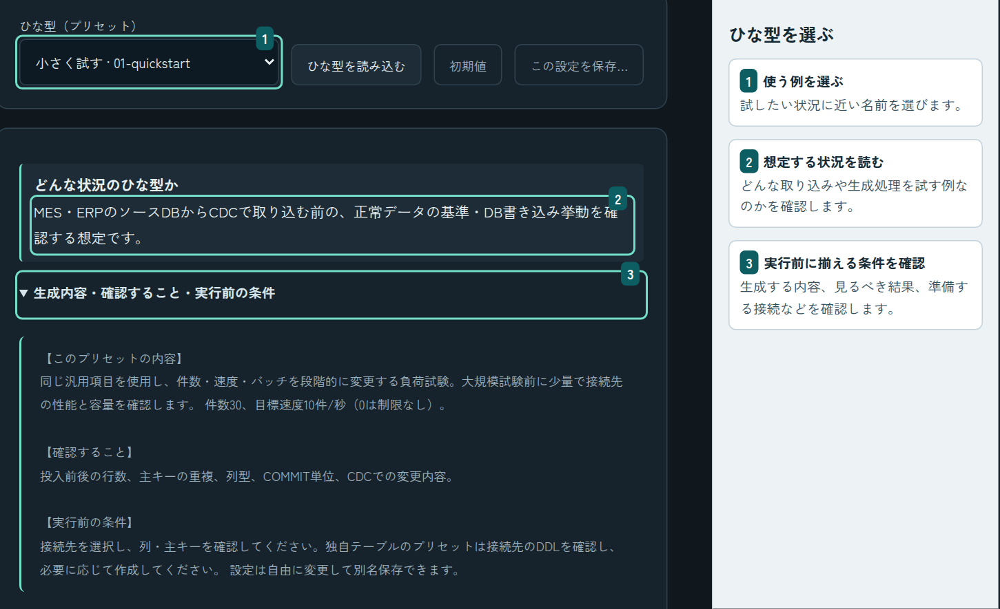
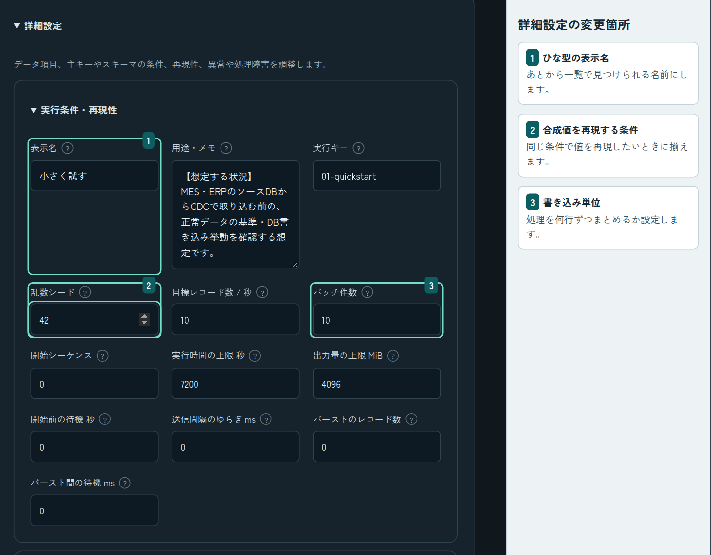

# SQLデータ投入のひな型と詳細設定

ひな型（プリセット）は、生成するデータの項目・件数・書式や、再現したい異常をまとめた設定です。試したい状況に近いひな型を読み込み、見本を確認してから必要な設定を変えます。公開、書き込み、送信を始めるときは、画面の実行ボタンを使います。

## ひな型を選ぶ

**小さく試す（01-quickstart）** を例にします。

MES／ERPからCDCや取り込み処理へ渡す前に、DBに書く列、主キー、型を確認する場面です。少量から始めると対象テーブルと書き込み方法を追いやすくなります。

「小さく試す」を選び、「ひな型を読み込む」を押します。基本設定で件数を3にし、検証用SQLiteと専用テーブルを選びます。

「どんな状況のひな型か」で用途を確認し、「生成内容・確認すること・実行前の条件」で作るデータや準備を読みます。

「10万件 / 負荷計測（02-volume-100k）」は容量と性能の比較向けです。数件の試験に通った専用テーブルを使って測定します。

全ひな型の用途は[プリセット一覧](../presets/README.md)を参照してください。

## 詳細設定を変更して見本を見る

「詳細設定 → 実行条件・再現性」で「乱数シード」を42にします。「データ項目・生成ルール」で列の型や値の作り方を確認します。

| 設定 | 変えられること |
| --- | --- |
| 乱数シード | 同じ合成値を再現するときに揃える値です。 |
| バッチ件数 | 書き込みをまとめる行数です。 |
| データ項目・生成ルール | 列名、型、主キーと、連番・固定値・分布などの生成条件を決めます。 |

**見本での確認**　「データの見本を見る」で id や連番などの列と値を確認します。書き込みは、検証用テーブルの列と主キーが揃っていることを確認してから実行します。

## 自分のひな型を作って保存する

1. 上の例で編集した設定を残すには、「この設定を保存…」を押します。今の設定がJSON欄に入った保存画面が開きます。
2. 「プリセットID」に `guide-sql-three-rows` のような新しいIDを入力します。半角英数字、ハイフン、下線が使えます。同じIDで保存すると、そのひな型を更新します。
3. 必要に応じて表示名と想定する状況を入力し、「ひな型として保存」を押します。画面で編集した設定は、JSON欄を書き直さず保存できます。
4. 生成画面の「ひな型（プリセット）」に戻り、新しく保存したIDを選んで「ひな型を読み込む」を押します。見本を出し、変更した条件が戻っていることを確認します。

たとえば別のテーブル向けにひな型を作るときは、「詳細設定 → データ項目・生成ルール」で入力先の列名、型、主キーを揃えます。設備コードなら `equipment_code` のような名前を付け、文字列の固定値を設定します。件数を `3` にして見本で列名と値を確認し、対象テーブルと用途が分かる名前で保存します。

共有するひな型には「SQLの書き込み前に3件を確認」のような表示名と、「検証用SQLiteで列型と主キーを確認する。」のような用途を書いておくと、次の人が選びやすくなります。接続先と認証は「接続先」で管理します。ひな型を別環境で使う場合は「JSONを書き出す」で持ち出し、利用先で接続設定を選び直します。

[操作ガイドに戻る](../README.md#操作ガイド)
