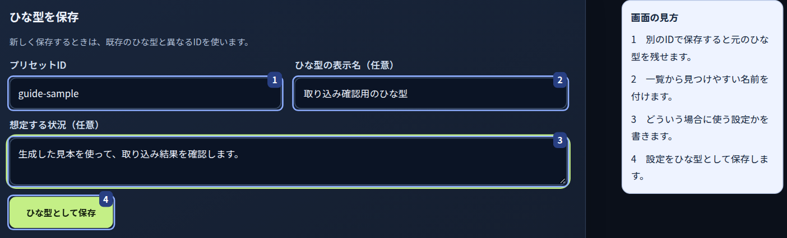
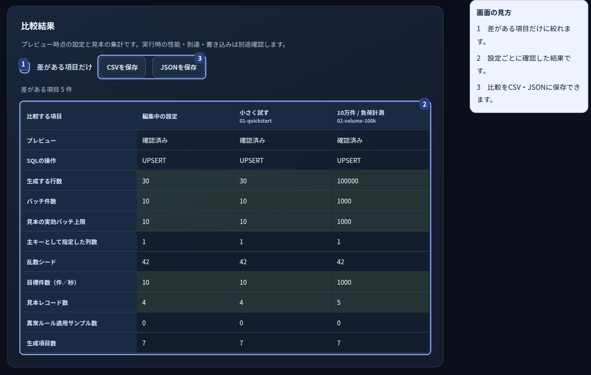

# SQLデータ投入のひな型と詳細設定

ひな型（プリセット）は、生成するデータの項目・件数・書式や、再現したい異常をまとめた設定です。試したい状況に近いひな型を読み込み、見本を確認してから必要な設定を変えます。公開、書き込み、送信を始めるときは、画面の実行ボタンを使います。

## 選び方

最初に正常な少量のひな型を試します。その後は設定を一つずつ変更すると結果を比較できます。

| 確認したいこと | 選ぶひな型 | 最初に見る結果 |
| --- | --- | --- |
| 初回の列・主キー・INSERTの確認 | 小さく試す（`01-quickstart`） | 3件に減らしてSQLiteで見本、テーブル作成、追加を順に確認します。 |
| 同じ値を繰り返す取り込み試験 | 固定値 / 基準データ（`05-constant-baseline`） | 固定の列と一意にする主キーを見本で区別します。 |
| 複数列の組み合わせで行を識別するテーブル | 複合主キー / グループと番号（`18-composite-key`） | 見本のキー列を接続先の複合主キーと照合します。 |

[付属のひな型一覧](../presets/README.md)のブラウザー版では、名前・ID・用途で検索できます。

## 読み込み・見本・保存・実行

- 読み込むと編集欄を置き換えます。編集中の内容を残すには別のIDで保存します。
- 見本で確認できるのは一部の値と形です。実行すると対象へ出力・公開します。
- 保存したひな型は次回から選べます。接続先や認証は使用する環境で選びます。

## 読み込みから見本まで

**小さく試す（01-quickstart）** を例にします。

MES／ERPからCDCや取り込み処理へ渡す前に、DBに書く列、主キー、型を確認する場面です。少量から始めると対象テーブルと書き込み方法を追いやすくなります。

「小さく試す」を選び、「ひな型を読み込む」を押します。基本設定で件数を3にし、検証用SQLiteと専用テーブルを選びます。

「どんな状況のひな型か」で用途を確認し、「生成内容・確認すること・実行前の条件」で作るデータや準備を読みます。

「10万件 / 負荷計測（02-volume-100k）」は容量と性能の比較向けです。数件の試験に通った専用テーブルを使って測定します。

全ひな型の用途は[プリセット一覧](../presets/README.md)を参照してください。

## 詳細設定を変更して見本を見る

「詳細設定 → 実行条件・再現性」で「乱数シード」を42にします。「データ項目・生成ルール」で列の型や値の作り方を確認します。

| 設定 | 変えられること |
| --- | --- |
| 乱数シード | 同じ合成値を再現するときに揃える値です。 |
| バッチ件数 | 書き込みをまとめる行数です。 |
| データ項目・生成ルール | 列名、型、主キーと、連番・固定値・分布などの生成条件を決めます。 |

**見本での確認**　「データの見本を見る」で id や連番などの列と値を確認します。書き込みは、検証用テーブルの列と主キーが揃っていることを確認してから実行します。

## 自分のひな型を作って保存する

1. 上の例で編集した設定を残すには、「この設定を保存…」を押します。今の設定がJSON欄に入った保存画面が開きます。
2. 「プリセットID」に `guide-sql-three-rows` のような新しいIDを入力します。半角英数字、ハイフン、下線が使えます。同じIDで保存すると、そのひな型を更新します。
3. 必要に応じて表示名と想定する状況を入力し、「ひな型として保存」を押します。画面で編集した設定は、JSON欄を書き直さず保存できます。
4. 生成画面の「ひな型（プリセット）」に戻り、新しく保存したIDを選んで「ひな型を読み込む」を押します。見本を出し、変更した条件が戻っていることを確認します。

たとえば別のテーブル向けにひな型を作るときは、「詳細設定 → データ項目・生成ルール」で入力先の列名、型、主キーを揃えます。設備コードなら `equipment_code` のような名前を付け、文字列の固定値を設定します。件数を `3` にして見本で列名と値を確認し、対象テーブルと用途が分かる名前で保存します。

共有するひな型には「SQLの書き込み前に3件を確認」のような表示名と、「検証用SQLiteで列型と主キーを確認する。」のような用途を書いておくと、次の人が選びやすくなります。接続先と認証は「接続先」で管理します。ひな型を別環境で使う場合は「JSONを書き出す」で持ち出し、利用先で接続設定を選び直します。

## 複数のひな型を比較する

メニューの「見本を比較」を開きます。SQLの操作種別、行数、主キー、バッチ件数、乱数シードを比べます。

1. 「名前・ID・用途」にキーワードを入力します。よく使うひな型は「お気に入り」を押すと、このブラウザーの「お気に入りのみ」で絞り込めます。「編集画面で選ぶ」を押すと、編集画面でそのひな型が選ばれます。「ひな型を読み込む」を押すと編集欄へ反映されます。
2. 比べたいひな型を最大3件選びます。画面で編集した設定も比べる場合は「編集中の設定を含める」をオンにします。検索条件を変えても選択は維持され、下の「比較する条件」に選んだIDが残ります。
3. 「見本を比較」を押します。複数の候補を順番にプレビューします。「残りを中止」を押すと、処理中のプレビューが終わった時点で残りを止めます。「要確認」の候補は編集画面で設定を見直し、通常のプレビューで詳細を確認します。
4. 比較結果は「差がある項目だけ」で絞り込めます。「CSVを保存」または「JSONを保存」で、ひな型ID・確認状況・比較項目の値を記録できます。接続情報や生成した本文は比較ファイルに含まれません。対象の設定を変えたら比較をやり直します。

## 項目から探す

[設定リファレンス](settings-reference.md)で、画面の設定名・JSONキー・既定値・許容範囲を確認できます。

[JSONの書き方](template-guide.md)には最小構成の例と生成器の使い分けがあります。AIへの作成依頼には[テンプレート作成ハーネス](AI_TEMPLATE_HARNESS.md)を使えます。

[初めて使う](user-manual.md)
