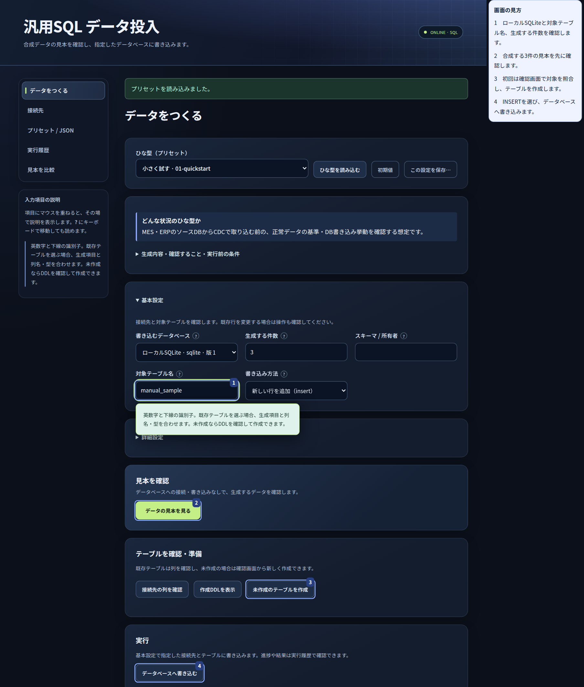

# 汎用SQLデータ投入ツール 操作マニュアル

合成データをデータベースへ書き込み、列型・キー・CDCによる取り込みを検証します。入力先に合わせて列と値の生成ルールを指定でき、MES／ERPの例はひな型として使えます。

## 最初に試すこと

**検証用SQLiteにテーブルを作って3行追加する**。実行履歴に完了と3件が表示され、`manual_sample` に3行が追加されます。

[Docker Compose導入手順](vm-compose.md)で準備し、VMで `http://127.0.0.1:3560/` を開きます。

SQLiteは別のDBサーバーを用意せずに試せる、ファイルに保存するデータベースです。「接続先」の「ローカルSQLite」を選び、作業用テーブル名に `manual_sample` を使います。既存の試験と分ける場合は別名にします。

1. 「データをつくる」で「小さく試す」を読み込み、「書き込むデータベース」をローカルSQLiteにします。
2. 対象テーブル名を `manual_sample`、生成する件数を `3`、書き込み方法を「新しい行を追加（insert）」にします。
3. 「データの見本を見る」で列名と値を確認します。初回は「未作成のテーブルを作成」の確認画面で対象を照合して作成し、「接続先の列を確認」で列と主キーを見ます。
4. 「データベースへ書き込む」を押し、確認画面の操作と件数を読んで実行します。「実行履歴」で完了と追加件数を見ます。

## よくある質問

### 主キーとは何ですか？

行を一意に見分ける列です。`id` が主キーなら同じ `id` の別の行は作れません。試験を繰り返す場合は、試験テーブルを分けるか重複しない値を用意します。

### INSERT、UPDATE、UPSERT、DELETEの違いは？

INSERTは追加、UPDATEは指定したキーの既存行を更新、UPSERTは一致する行を更新しなければ追加、DELETEは一致する行を削除します。まずINSERTで比較用の結果を作ります。

### 途中で停止すると元に戻りますか？

確定済みのバッチが残ることがあります。実行履歴とDBの両方を確認してから次の実行を決めます。

## 停止と再起動

生成ジョブは指定件数で完了します。停止や失敗後は、すでに確定したバッチが残る場合があるため、ジョブの確定件数とDBを確認してから次の実行を決めます。

## 想定した結果が出ないとき

接続先が選べても対象DBに権限があるとは限りません。書き込み対象、認証、テーブルの行・鍵、権限を順に照合します。

## SQL日時と主キーの扱い

日時はタイムゾーン付きで入力し、値をUTCに変換します。生成するDDLでタイムゾーンを保持しない日時列に書き込む場合は、読み取り側でUTCとして扱います。主キーは、追加後にその行を更新・削除するためにも必要です。複合主キーの場合はすべてのキー列の値を照合してください。

| 生成の型 | テーブル作成時の列の考え方 |
| --- | --- |
| integer | 整数列 |
| number | 浮動小数点数列 |
| decimal | 指定した精度・小数桁数の数値列 |
| datetime | UTC値を入れる日時列。DBによってDATETIMEやDATETIME2等に変換します。 |
| json | JSON表現を保存するテキスト列。 |

## 次に読む

- [ひな型を選ぶ・作る](preset-guide.md)
- [設定リファレンス](settings-reference.md)
- [JSONの書き方](template-guide.md)
- [APIの使い方](api-guide.md)
- [用語集](glossary.md)
